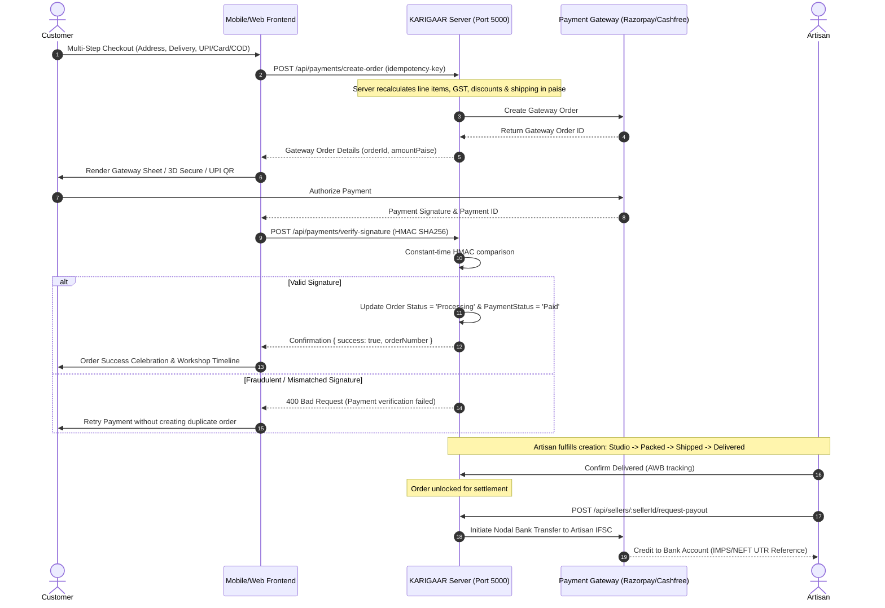

# KARIGAAR Handmade Marketplace: Payment & Seller Payout Setup Guide

This document outlines the merchant onboarding, regulatory compliance, gateway integration, and production deployment procedures for the **KARIGAAR** handmade marketplace.

---

## 1. Regulatory Compliance & RBI Framework

Under Reserve Bank of India (RBI) **Guidelines on Regulation of Payment Aggregators and Payment Gateways (PA-PG)**, marketplace platforms collecting funds on behalf of independent sellers must adhere to strict nodal/escrow account norms:

1. **No Direct Intermediary Pool**: Marketplace operators cannot pool customer funds directly into a generic current account. Customer payments must be collected into an RBI-regulated **Escrow Account** managed by an authorized Payment Aggregator (e.g., Razorpay Route or Cashfree Marketplace).
2. **Settlement Timing (T+2 / Delivery-Linked)**: Seller payouts must only be disbursed after fulfillment delivery confirmation or past the return window (standard policy: 7-day maker satisfaction guarantee).
3. **Artisan GST Exemption (Notification No. 34/2023 - Central Tax)**:
   - Genuine handmade artisans with an annual turnover under ₹20 Lakhs (or ₹40 Lakhs for goods in eligible states) are **exempt from mandatory GST registration** when selling through e-commerce operators.
   - KARIGAAR captures the Artisan's PAN and Enrolment ID (generated on the GST Portal) to comply with tax reporting without burdening small-scale makers.

---

## 2. Supported Payment Providers & Marketplace Modes

| Provider | Marketplace Product | Settlement Method | Best For |
| :--- | :--- | :--- | :--- |
| **Razorpay** | **Razorpay Route** | Automated Linked Account Split | Direct split of marketplace commission and artisan payout |
| **Cashfree** | **Cashfree Easy Split** | Vendor Split via Virtual Accounts | Instant IMPS/NEFT vendor transfers with IFSC validation |

### Sandbox / Development Mode
The backend includes a mock signature generator and gateway emulator in `server/src/services/paymentService.js` that mirrors Razorpay's HMAC SHA-256 validation algorithms for local development without live merchant credentials.

---

## 3. Environment Variables Configuration

Copy `server/.env.example` to `server/.env` and update the keys:

```env
# Server Port
PORT=5000
NODE_ENV=development

# Payment Provider: 'razorpay' | 'cashfree' | 'mock'
GATEWAY_PROVIDER=razorpay

# Razorpay Sandbox / Live API Keys
RAZORPAY_KEY_ID=rzp_test_mockKeyId12345
RAZORPAY_KEY_SECRET=rzp_test_mockSecretToken67890
RAZORPAY_WEBHOOK_SECRET=karigaar_whsec_test_secret_998877

# Cashfree Sandbox / Live Keys (Optional)
CASHFREE_APP_ID=
CASHFREE_SECRET_KEY=

# Financial Defaults
DEFAULT_PLATFORM_COMMISSION_PCT=10
GATEWAY_FEE_PCT=2
TAX_GST_PCT=5
```

> [!WARNING]
> Never commit `.env` or production API secret keys to version control. Set them via secure environment variables in hosting environments (AWS Parameter Store, Vercel, Railway, or Heroku Config Vars).

---

## 4. End-to-End Payment Workflow



---

## 5. Webhook Listener Configuration

1. Log into your Razorpay/Cashfree Merchant Dashboard.
2. Navigate to **Settings > Webhooks > Add New Webhook**.
3. Set the Webhook URL:
   ```
   https://api.yourdomain.com/api/webhooks/razorpay
   ```
4. Subscribe to the following events:
   - `order.paid`
   - `payment.captured`
   - `payment.failed`
   - `refund.processed`
   - `settlement.processed`
5. Copy the generated **Webhook Secret** and paste it into `RAZORPAY_WEBHOOK_SECRET` in `server/.env`.
6. Webhook payloads are verified using constant-time `crypto.timingSafeEqual` with raw HTTP request bodies to prevent tampering.

---

## 6. Security Guarantees & Safeguards

- **No Raw Card Storage**: Raw credit/debit card numbers, CVVs, and UPI PINs are never received or logged on KARIGAAR servers (PCI-DSS Level 1 compliance delegated to gateway SDKs).
- **Server-Side Pricing Invariance**: Line-item unit prices, coupon discount caps, and taxes are fetched and calculated on the server from the database. Client attempts to submit modified total prices are strictly ignored.
- **Idempotency Protection**: Every checkout attempt generates a UUIDv4 idempotency key. Repeating requests with the same key safely returns the existing order instead of double-charging.
- **Double-Settlement Prevention**: Orders must be in `'Delivered'` and `'Paid'` state to qualify for settlement. Commission records are marked `settled: true` with a unique UTR reference upon disbursement.

---

## 7. Running the Application Locally

1. **Start the Payment Backend**:
   ```bash
   node server/src/index.js
   # Or via npm script:
   npm run server
   ```
   Backend URL: `http://localhost:5000`

2. **Start the Web Frontend**:
   ```bash
   npx expo start --web
   ```
   Frontend URL: `http://localhost:8081`

3. **Run the Automated Payment Test Suite**:
   ```bash
   npm run test:backend
   ```
   All 13 comprehensive automated tests verify:
   - Successful payment & HMAC SHA256 signature verification
   - Failed payment & signature forgery rejection
   - Cancelled checkout / modal dismissal handling
   - Delayed or missing webhook resilience
   - Duplicate webhook idempotency
   - Payment retry without duplicate orders
   - Tampered checkout amount (server-side price enforcement)
   - Out-of-stock item inventory validation
   - Duplicate payment request prevention
   - Refund and cancellation with seller commission withholding
   - Multiple sellers in single order with category commission calculations
   - Seller payout double-settlement prevention & delivery requirement
   - Access permissions & seller financial isolation

---

## 8. Sandbox vs Live Payments Checklist

| Feature | Sandbox / Test Mode (Ready Now) | Live Production Mode (Requires Merchant Verification) |
| :--- | :--- | :--- |
| **Payment Orders** | Emulated / Verified with Razorpay sandbox keys (`rzp_test_...`) | Real money deduction via registered Razorpay Live merchant account |
| **Checkout UI** | Real Razorpay Standard Checkout popup (`checkout.js`) with test cards/UPI | Real Razorpay Checkout processing Indian bank cards, UPI apps, and Netbanking |
| **Signature Verification** | Strict HMAC SHA-256 validation on server | Strict HMAC SHA-256 validation on server using production secret |
| **Seller Payouts** | Auditable simulated settlements with unique UTR references & delivery gates | Real RBI Nodal / Escrow transfers via Razorpay Route or Cashfree Marketplace Split |
| **Compliance** | Full schema & state machine ready | Requires business KYC, Bank Account Verification, and PAN/GST exemption filings |

> [!IMPORTANT]
> Live money collection and real seller settlements must remain disabled until your business account approval, API credentials, and webhook secrets are configured and tested. Never claim live payments are operational until verified with real merchant credentials.
